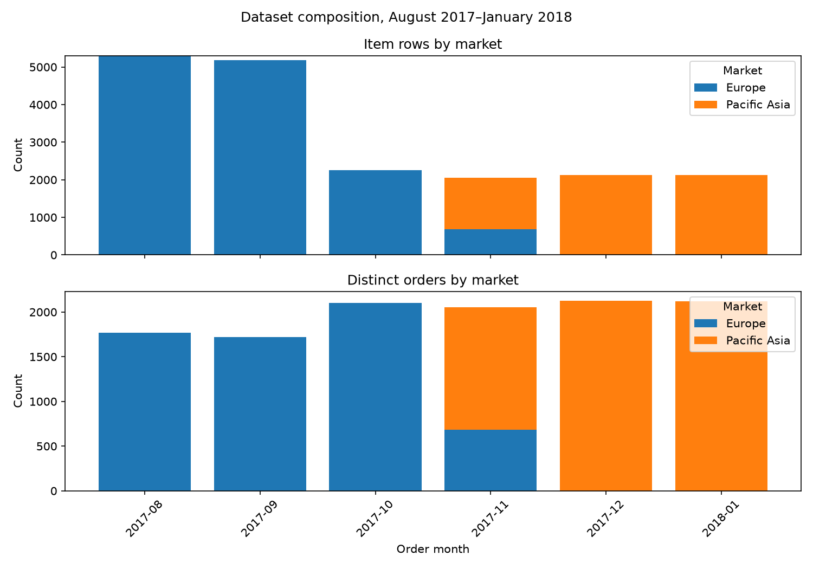
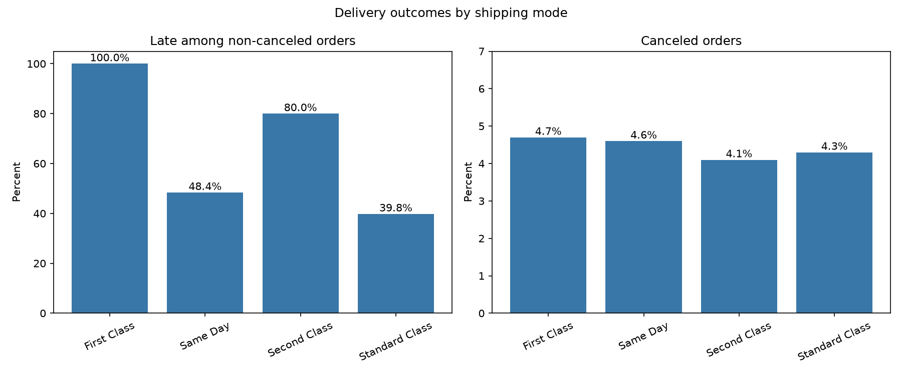

# Data Portfolio

## DataCo Supply Chain Analysis

This project explores delivery status by shipping mode and changes in the dataset’s market and order composition over time.

**Dataset source:** [DataCo Smart Supply Chain for Big Data Analysis on Kaggle](https://www.kaggle.com/datasets/shashwatwork/dataco-smart-supply-chain-for-big-data-analysis).

### Data composition changes near the end of the dataset

From August through October 2017, the records shown here are from Europe. November includes both Europe and Pacific Asia; December 2017 and January 2018 show Pacific Asia only.

The relationship between item rows and distinct orders also changes:

- September 2017: 5,189 item rows across 1,723 orders, or about 3.01 item rows per order.
- October 2017: 2,255 item rows across 2,101 orders, or about 1.07 item rows per order.
- November 2017 through January 2018: item rows equal distinct orders in each month.

The drop in item rows per order appears across shipping modes and order statuses. This indicates a change in the dataset’s composition. Its cause is unknown, so these months should not be interpreted as evidence of a real business decline or growth without additional source context.

The chart compares monthly item rows and distinct orders by market. Counts are at the order-item and order levels, respectively.



### Delivery status by shipping mode

At the order level, late-status rates differ by shipping mode. Among non-canceled orders, 100% of First Class orders are labeled late, compared with 48.4% for Same Day, 80.0% for Second Class, and 39.8% for Standard Class.

A descriptive split by year and market shows a similar pattern in the groups observed: First Class remains at 100% late, Second Class is generally around 75–81%, and Standard Class is generally around 38–41%. This suggests the aggregate pattern is not explained solely by changes in year and market mix. Some groups are small, so their percentages are less stable.

A chi-square test found an association between shipping mode and late status in this dataset (χ²(3) = 14,530.75, p < 1×10⁻³⁰⁰; Cramér’s V = 0.481). These are observational results based on the dataset’s delivery labels. They do not establish that shipping mode causes late delivery.



### Published data files

The `aws-data-engineering/supply_chain_dataset/published/` folder contains the curated dataset used by this project and three CSV summaries produced by the analysis scripts. The original source files and intermediate working data are kept locally in the ignored `data/` folder.

The curated dataset is about 58 MB. GitHub may show a warning because it exceeds 50 MiB, but it is below GitHub’s 100 MiB file limit.

### Reproduce the project locally

Requires Python 3.14, pandas, and matplotlib. SQLite is included with Python. Place the three source CSVs in `aws-data-engineering/supply_chain_dataset/` before running ingestion.

From the repository root, run these commands in order:

```powershell
cd aws-data-engineering/supply_chain_dataset
py -3.14 quality_checks.py
py -3.14 ingest_local.py
py -3.14 transform_local.py
py -3.14 sql_analysis.py
py -3.14 monthly_coverage.py
py -3.14 monthly_mix.py
py -3.14 plot_coverage_change.py
py -3.14 delivery_kpis.py
py -3.14 plot_delivery_kpis.py
py -3.14 delivery_mode_stats.py
py -3.14 late_rate_by_market_year.py
```

### AWS implementation files

The `aws/glue/` folder contains a Glue ETL script for building the analytical tables. The `sql/athena/` folder contains Athena table definitions and analysis queries. The data model was built and validated locally with SQLite; the Glue and Athena code is prepared for AWS but has not been run against AWS services.

To use the Athena table definitions, replace `YOUR_BUCKET_NAME` in the S3 locations with your bucket name.